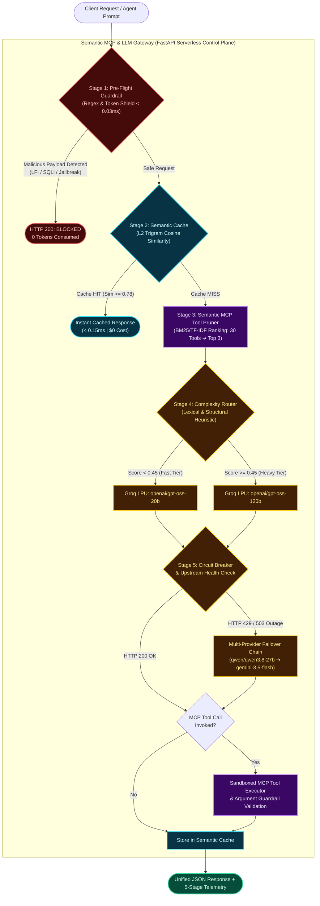

# Semantic MCP & LLM Gateway

An enterprise AI infrastructure control plane that dynamically prunes MCP tool schemas, caches semantically equivalent queries, intercepts adversarial prompt injections, and orchestrates resilient multi-provider LLM failover.

[](https://semantic-mcp-gateway.vercel.app)
[](https://fastapi.tiangolo.com/)
[](https://nextjs.org/)
[](https://www.python.org/)

---

## Overview

Transitioning Large Language Models (LLMs) and autonomous agents from prototype to production introduces critical infrastructure bottlenecks: runaway token bills, redundant API calls, untrusted tool execution, and single-provider outages. These challenges are amplified when adopting the **Model Context Protocol (MCP)**—connecting an LLM to dozens of enterprise tools bloats every prompt with massive JSON schema definitions, degrading both Time-to-First-Token (TTFT) and tool-calling precision on smaller models.

**Semantic MCP & LLM Gateway** acts as a high-throughput serverless middleware layer between client applications and upstream AI providers. By combining sub-millisecond BM25/TF-IDF tool-schema pruning, character n-gram semantic caching, complexity-based compute routing, and automated multi-provider circuit breaking, the gateway eliminates redundant inference costs and guarantees high availability.

---

## System Architecture & 5-Stage Pipeline

GitHub renders the Mermaid architecture diagram below automatically:



### Pipeline Stages Explained

1. **Stage 1 — Pre-Flight Security Guardrail (`< 0.03ms`):** A deterministic ingress filter inspects both incoming user prompts and outgoing LLM-generated MCP tool arguments against compiled signatures for Path Traversal (`../../etc/passwd`), destructive SQL injection (`DROP TABLE`), credential exposure, and adversarial system overrides.
2. **Stage 2 — Vector Semantic Cache (`< 0.15ms`):** Queries undergo synonym canonicalization, suffix stemming, and L2-normalized character 3-gram vectorization. If cosine similarity against recent traffic meets or exceeds `0.78`, the gateway short-circuits the LLM and returns the cached payload immediately.
3. **Stage 3 — Semantic MCP Tool Pruner (`< 0.10ms`):** Rather than stuffing all 30 registered enterprise MCP tool schemas (`2,208` tokens) into every prompt, a custom BM25/TF-IDF inverted index ranks tool descriptions against the query and binds only the **top-3 relevant tools (`~230` tokens)**—cutting schema token overhead by **~89%**.
4. **Stage 4 — Complexity Scorer & Tier Router:** Evaluates prompt length, code/JSON structures, and algorithmic reasoning markers on a `0.0–1.0` scale, routing routine operational queries to the fast 20B tier (`openai/gpt-oss-20b`) and complex architectural design tasks to the 120B reasoning tier (`openai/gpt-oss-120b`).
5. **Stage 5 — Multi-Provider Circuit Breaker & Sandboxed Execution:** If the primary provider experiences an outage (`HTTP 503`) or rate limit (`HTTP 429`), the circuit breaker automatically trips and cascades across backup models (`qwen/qwen3.8-27b` and Google `gemini-3.5-flash`) without dropping the request.

---

## Project Directory Structure

```text
semantic-mcp-gateway/
├── api/                              # Python Serverless Backend (FastAPI + MCP Engine)
│   ├── __init__.py                   # Marks api/ as a Python package
│   ├── index.py                      # FastAPI entrypoint (/api/execute, /api/tools, /api/health)
│   ├── core/                         # Core Gateway Control Plane Modules
│   │   ├── __init__.py
│   │   ├── guardrails.py             # Stage 1: Deterministic regex/token ingress shield (<0.03ms)
│   │   ├── cache.py                  # Stage 2: N-gram & stemmed token cosine-similarity cache
│   │   ├── router.py                 # Stage 4: Complexity heuristic scorer (Fast 20B vs Heavy 120B)
│   │   └── circuit_breaker.py        # Stage 5: Multi-provider failover state machine
│   └── mcp_engine/                   # Model Context Protocol (MCP) Subsystem
│       ├── __init__.py
│       ├── registry.py               # Stores 30 enterprise MCP tool JSON schemas (Git, SQL, Docker, etc.)
│       ├── tool_pruner.py            # Stage 3: BM25/TF-IDF ranker pruning 30 tools -> top 3 (-89% tokens)
│       └── tools.py                  # Sandboxed MCP tool executor & tool-argument security validator
├── app/                              # Next.js App Router Frontend ("Mission Control" UI)
│   ├── favicon.ico
│   ├── globals.css                   # Tailwind CSS global styles
│   ├── layout.tsx                    # Root HTML shell & typography configuration
│   └── page.tsx                      # Interactive gateway playground, chaos toggles & telemetry UI
├── public/                           # Static assets & architecture diagrams
├── core_gateway.py                   # Standalone unified CLI engine & 5-stage benchmark test harness
├── next.config.ts                    # Hybrid dev/cloud API routing configuration
├── postcss.config.mjs                # Tailwind v4 PostCSS plugin pipeline
├── requirements.txt                  # Python serverless dependencies for Vercel build
├── vercel.json                       # Edge rewrite rules mapping /api/(.*) -> /api/index.py
└── package.json                      # Next.js, React, TypeScript & Tailwind dependencies
```

---

## Empirical Benchmarks

| Evaluation Metric | Benchmark Score | Architectural Significance |
| :--- | :---: | :--- |
| **MCP Schema Token Reduction** | **88.3% – 90.4%** | Pruned 30 MCP tool schemas (`2,208` tokens) down to the top-3 tools (`~225` tokens) in `0.08ms` with 100% Top-1 recall. |
| **Semantic Cache Paraphrase Latency** | **0.14ms** | Intercepted paraphrased technical queries (`0.93+` cosine similarity), yielding a `~6,000x` speedup over live LLM inference. |
| **Pre-Flight Guardrail Latency** | **0.004ms – 0.026ms** | Blocked LFI path traversal and SQL injection attacks in microseconds before consuming upstream API tokens. |
| **Upstream Outage Recovery Rate** | **100%** | Seamlessly failed over from simulated `HTTP 503` primary outages to secondary model providers without dropping requests. |

---

## Tech Stack

* **Backend & API Framework:** Python 3.14, FastAPI, Uvicorn, AsyncIO, Pydantic v2
* **AI & MCP Orchestration:** Model Context Protocol (MCP) Tool Schemas, Native JSON Function Calling, Sandboxed Tool Argument Validation
* **NLP & Retrieval Algorithms:** Custom BM25 / TF-IDF Inverted Index, Character 3-Gram & Stemmed L2 Cosine Similarity, Regex / Lexical Heuristic Scoring
* **Upstream LLM Providers:** Groq LPU Cloud (`openai/gpt-oss-20b`, `openai/gpt-oss-120b`, `qwen/qwen3.8-27b`), Google GenAI SDK (`gemini-3.5-flash`, `gemini-3.7-flash`)
* **Frontend & Telemetry UI:** Next.js (App Router), React 19, TypeScript, Tailwind CSS v4
* **Cloud & Deployment:** Vercel Serverless Functions (Hybrid Python + Node.js Edge Routing)

---

## Local Development Quickstart

### 1. Clone & Configure Environment

```bash
git clone [https://github.com/irvallensar/semantic-mcp-gateway.git](https://github.com/irvallensar/semantic-mcp-gateway.git)
cd semantic-mcp-gateway

python3 -m venv .venv
source .venv/bin/activate
pip install -r requirements.txt
npm install
```

Create a `.env` file in the root directory:

```ini
GROQ_API_KEY="gsk_your_groq_key"
GEMINI_API_KEY="AIzaSy_your_gemini_key"

FAST_MODEL="openai/gpt-oss-20b"
HEAVY_MODEL="openai/gpt-oss-120b"
FALLBACK_MODEL="gemini-3.5-flash"
```

### 2. Run the 5-Stage CLI Benchmark Suite

```bash
python core_gateway.py
```

### 3. Launch the Full-Stack Mission Control UI

Start the FastAPI backend and Next.js frontend:

```bash
# Terminal 1: FastAPI Backend (Port 8000)
source .venv/bin/activate
python -m uvicorn api.index:app --reload

# Terminal 2: Next.js Frontend (Port 3000)
npm run dev
```

Visit **`http://localhost:3000`** to interact with the live Mission Control playground, toggle simulated API outages, and inspect real-time telemetry.